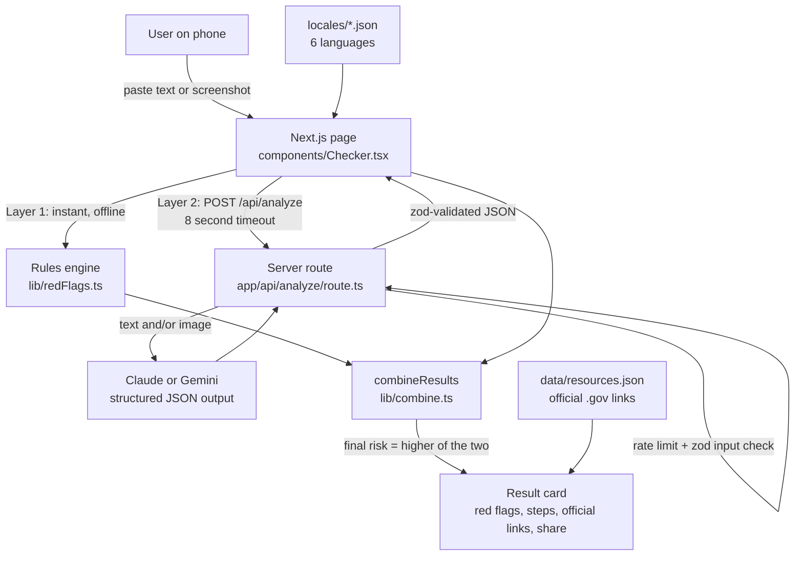

# Check First

**A multilingual scam checker for immigrant families and seniors in California's 14th district.**
Paste a message or upload a screenshot. Check First tells you, in your own language, how risky it is, which red flags it found, and exactly how to verify it with official sources before you pay anyone.

Congressional App Challenge 2026 entry (CA-14) by Viraj Mutti.

**Live app: https://check-first-sepia.vercel.app**

## The problem

Families in Fremont, Union City and Hayward get scam texts, WhatsApp forwards and phone calls every week:

- fake USCIS, IRS, Social Security and police calls threatening arrest or deportation
- *notarios* and "immigration consultants" who give illegal legal advice and take fees
- fake travel and visa agents promising a "guaranteed" visa or job abroad
- grandparent emergency calls, fake toll and package texts, prize scams

The people targeted most are often the least able to check. They may not read English well, may not know which government websites are real, and may be pressured to pay *right now*. Most scam-checking tools are English-only.

## Who it helps in CA-14

CA-14 is one of the most diverse districts in the country, with large Punjabi, Hindi-speaking, Spanish-speaking, Chinese and Afghan (Dari-speaking) communities, many of them seniors or recent immigrants. Check First works in all six of those languages, on a phone, with no account and no data saved.

## Features

- **Check a message**: paste text or upload a screenshot (PNG/JPG).
- **Risk level** (Low / Medium / High) shown with color, an icon and a text label, never color alone.
- **Red flags**, each explained in one plain sentence.
- **What to do now**: 3 to 5 concrete steps.
- **Verify it yourself**: official `.gov` links matched to the scam type (21 links, each opened in a browser to confirm it loads).
- **Share with family**: one-tap WhatsApp warning in the chosen language, plus a copy button.
- **6 languages**: English, ਪੰਜਾਬੀ, हिन्दी, Español, 中文, دری (with full right-to-left layout for Dari).
- **Accessibility**: large text, high contrast, 44px tap targets, full keyboard use, read-aloud (when the device has a voice for that language). Lighthouse accessibility score: 100.
- **/verify**: "Who are you dealing with?" Three steps and official links for consultants, lawyers, travel/visa agents, people claiming to be government, contractors and online sellers.
- **/learn**: six common scam cards in every language. Works offline.
- **Report it in English**: after a risky result, one tap copies a factual English report (written by the AI, or a template when offline) to paste into ReportFraud.ftc.gov, so families who don't read English can still report.
- **/help**: for people who already paid. Pick how you paid (Zelle, payment app, Western Union, gift card, crypto, cash, card, or shared your SSN or passport) and get what to do *right now*, based on the FTC's official advice. Also has tap-to-call official numbers (USCIS, SSA, IRS, FTC, Postal Inspection, 911), each checked on the agency's own website, and "what to say to a scammer" in your language, with read-aloud.
- **Installable mobile app**: on phones, Check First installs to the home screen with its own icon and opens full screen like a native app (Android: "Install app" button; iPhone: Share → Add to Home Screen). Phones get an app-style bottom tab bar; computers get a top menu. Learn and Help work offline once opened.
- **Privacy**: no database, no accounts, and messages are never stored or logged by Check First. The AI check sends the text to the AI provider to read it, and the app says so. Note: on Gemini's *free* tier, Google's terms allow it to use submitted content to improve its products, so a real launch should use a paid tier.

## Architecture



## How two-layer detection works

1. **Rules engine (layer 1).** `lib/redFlags.ts` runs in the browser. It scores the message 0–100 using weighted keyword and pattern rules across nine categories (threats, unusual payments, government impersonation, guarantees, upfront fees, secrecy, notarios, prizes, suspicious links) in all six languages. It needs no internet and no API key, and every result is explainable: the screen shows the exact words that matched.
2. **AI analysis (layer 2).** `app/api/analyze/route.ts` sends the message (and screenshot, if any) to an AI on the server: **Claude** if an Anthropic key is set, otherwise **Gemini** (which has a free tier). Each provider lives in its own small file (`lib/ai/claude.ts`, `lib/ai/gemini.ts`) and shares one prompt (`lib/ai/prompt.ts`). The AI must answer in strict JSON: `{risk, scamType, redFlags[{flag, explanation}], nextSteps[], summary}`, written in the user's language. The server checks that JSON again with **zod** before trusting it.
3. **Combine.** The final risk is the **higher** of the two layers, and the result shows each layer's verdict side by side, so it's clear which layer flagged what.
4. **Never a blank screen.** If the AI is slow (over 8 seconds), fails, refuses, is rate limited, or the device is offline, the app shows the rules result with a small notice explaining why.

## The hardest technical challenge

**Getting a reliable answer in six languages from an AI that can fail, without ever leaving a scared user staring at a spinner or an error.**

AI output can be slow, cut off, or shaped wrong, and a user checking a scam call is often under pressure. The solution has four parts:

- **Strict shape.** The AI (Claude or Gemini) is asked for structured JSON output generated from one zod schema, then the server validates it a second time with zod (`AiAnalysisSchema`). Anything that doesn't match is treated as a failure.
- **Hard time limit.** Both the browser (`AbortController`) and the server SDK stop after 8 seconds.
- **Offline first layer.** The rules engine always runs first, in the browser, so there is always a result to fall back to.
- **Screenshots feed both layers.** When only a screenshot is sent, the AI also returns the text it read (`extractedText`), and the rules engine re-runs on that text. A screenshot gets two independent checks too.

A second challenge was **multilingual text handling**. JavaScript's `\b` word boundary only understands English letters, so Punjabi, Hindi, Chinese and Dari keywords need different matching. Dari also needs right-to-left layout, the invisible joiner character (ZWNJ) in words like پیام‌ها, and its own font. A test (`lib/locales.test.ts`) guarantees every language has every string.

## Run it yourself

Requirements: Node.js 20+.

```bash
git clone <this repo>
cd check-first
npm install
cp .env.example .env.local   # then add an Anthropic or Gemini API key
npm run dev                  # http://localhost:3000
```

Without an API key the app still works: it uses the rules engine only and says so.

| Command | What it does |
|---|---|
| `npm run dev` | Development server |
| `npm test` | Unit tests (rules engine, translations, official links) |
| `npm run typecheck` | TypeScript check |
| `npm run lint` | ESLint |
| `npm run build` | Production build |

Environment variables (server only, never sent to the browser):

| Name | Required | Default |
|---|---|---|
| `ANTHROPIC_API_KEY` | one of the two keys, for the AI layer | none |
| `ANTHROPIC_MODEL` | no | `claude-sonnet-5-5` |
| `GEMINI_API_KEY` | used only if there's no Anthropic key (free tier at aistudio.google.com) | none |
| `GEMINI_MODEL` | no | `gemini-3.5-flash-lite` |

## Tech stack

Next.js (App Router) · TypeScript · Tailwind CSS · Anthropic SDK and Google GenAI SDK (server only) · zod · Vitest · Vercel.

## AI disclosure

This project used an AI coding assistant. [AI_USAGE.md](AI_USAGE.md) lists exactly what was AI-generated and what Viraj wrote. The rules engine logic in `lib/redFlags.ts` was written by Viraj. [LEARN.md](LEARN.md) walks through every file.

## Not legal advice

Check First gives general safety information and links to official sources. It is not legal advice. In an emergency, call 911.
